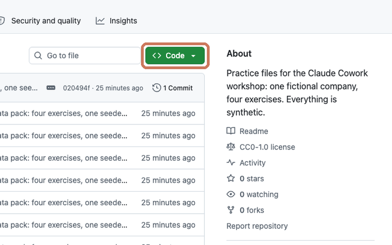
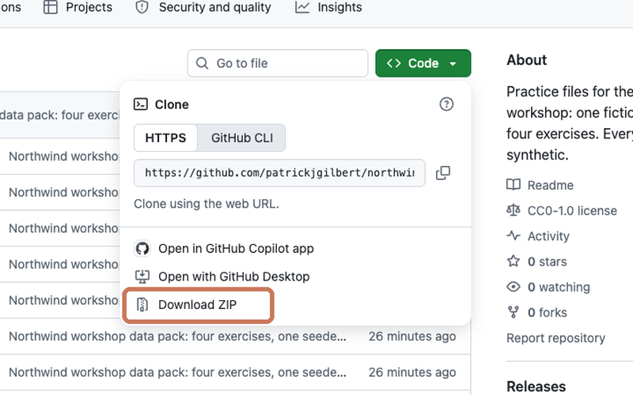
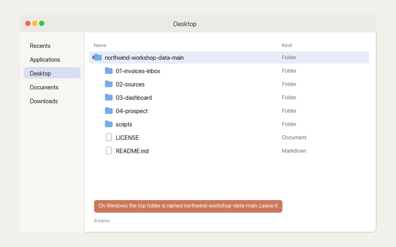

# Northwind: practice files for Claude Code

Practice files for the "Claude Code for Beginners" workshop. One fictional company, one folder, one session. Every file here is synthetic: the company, the people, the customers, the emails and the dollar figures. The pack is released under CC0 (public domain), so use it however you like.

## The company

Northwind Home Services is a cleaning and handyman company in Portland, Maine, run by Dana Whitfield. About $2.8 million a year in invoices. In the exercises, you are Dana.

## Get the files

1. Click the green **Code** button near the top of this page.

   

2. Choose **Download ZIP**.

   

3. Unzip it (double-click on a Mac; right-click and choose Extract All on Windows) and drag the folder to your Desktop.

   

The folder unzips as `northwind-claude-code-main`. That is normal.

Then open the Claude desktop app, click **Code**, choose **Local**, and open this folder.

## What's in the folder

| File | What it is |
|---|---|
| `CLAUDE.md` | Who Dana is and how she works. Claude Code reads it on its own at the start of every session. |
| `brand-guidelines.md` | Northwind's colors, fonts and chart rules |
| `sources/gmail-export/` | 8 email threads saved as PDFs |
| `sources/slack-export/ops-channel.txt` | the #ops channel, July to September |
| `sources/meeting-transcript-2026-09-18-ops.txt` | the September ops meeting |
| `sources/quickbooks-invoices-q3.csv` | every customer invoice in Q3 (129 rows) |
| `sources/quickbooks-bills-paid-q3.csv` | every vendor bill paid in Q3 (45 rows) |
| `sources/hubspot-deals.xlsx` | the sales pipeline (15 deals) |
| `sources/jobs-export.csv` | every scheduled job in Q3 (455 rows) |
| `sources/northwind-revenue-30mo.xlsx` | 30 months of revenue by customer and service line |

## The prompts

Claude desktop app, **Code** tab, **Local**, this folder, model **Opus 5.5**. Paste them in order, in the same chat.

**Warm-up**

```
What do you know about my business?
```

**1. Sources to workbook**

```
Reconcile what we promised customers in Q3 against what we invoiced. Put it in a workbook, then tell me the four things to fix first.
```

**2. Workbook to dashboard**

```
Now turn that into a dashboard, and add the 30-month revenue file. Lead with what I should worry about.
```

Don't like a chart? Drop a screenshot of it into the chat and paste:

```
I don't like this chart. How can we make it better? Give me three options.
```

**3. Dashboard to app**

```
Turn the dashboard into a what-if planner. Let me change handyman prices and hours per job, switch off Eastern Promenade, and watch revenue and margin move.
```

**4. Share it**

```
Make the planner an artifact so I can share it.
```

**Done early? Remix it**

```
Make the planner work on my phone.
```

```
Add a button that finds the handyman price that gets margin back to 60%.
```

```
Turn the six exceptions into a quiz for my office team. Make it fun.
```

**5. Make it a skill**

```
Turn this session into a skill called q3-review, so next quarter it's one line.
```

Then type `/` and you'll see `q3-review` in the list.

**Your own folder**

```
Interview me one question at a time, then write a CLAUDE.md for this folder.
```

The prompts are short because `CLAUDE.md` holds the rules: calculate, cite your sources, stop and ask, follow the brand, save to `output/`, build in one pass.

## If Claude stops to ask

`CLAUDE.md` tells Claude to stop and ask when something can be read two ways. These are the questions a careful run asks in step 1, with answers you can give.

| Question | Answer |
|---|---|
| Does Munjoy Hill Senior Residence count from July or August? | From July: $7,200. July is the start date in the signed deal. |
| Is Pleasant Hill Veterinary flat monthly or per visit? | Flat, $3,290 a month per HubSpot. Leave August as invoiced. September is $250 under. |
| What do we charge for the Tanabe-Morrill deck railing? | Flag it, don't price it. $0, "unpriced, flag only". |
| Do open deals count as promises? | No. Only Closed Won. |
| Is the Routeboard seat overbilling in scope? | No. Vendor bills only matter for duplicate payments. |
| Are the 7 cancelled jobs exceptions? | No. Customers cancelled them. |

## What's planted

Six exceptions, $11,904.60 at stake. With the answers above, Pleasant Hill Veterinary ($250) and Tanabe-Morrill (unpriced) are added, for $12,154.60.

| Exception | Dollars | Where it is |
|---|---|---|
| Munjoy Hill Senior Residence signed in July, never started | $7,200.00 | `hubspot-deals.xlsx` row 2; no jobs, no invoices |
| Back Cove Bakery handyman work done, never invoiced | $1,975.00 | `jobs-export.csv` J-13508, J-13538, J-13605 |
| Eastern Promenade credit promised, never applied | $1,200.00 | meeting transcript 00:01:39; INV-2089 |
| Casco Bay Janitorial invoice CB-2211 paid twice | $1,184.60 | BILL-10223 and BILL-10230 |
| Old Port Dental rate cut agreed, never billed | $160.00 | Old Port Dental email, Jul 28; INV-2066, INV-2108 |
| Priya Natarajan's free re-clean was invoiced | $185.00 | Slack Aug 19 15:45; INV-2047 |

In the 30-month revenue file:

- **Concentration.** Eastern Promenade Condominium Association is 31.0% of trailing-12-month revenue (about $862K of $2.78M). Nobody else is over 13%.
- **Handyman margin.** Crew hours per handyman job rose from about 2.2 to about 3.4 while the price stayed near $500. Margin fell from about 63% to about 45%.
- **Seasonality.** Rental turnovers peak June to August. July is about 4.5x January.
- **Work with no revenue.** Back Cove Bakery, August 2026: 3 handyman jobs, 9.25 hours, $0 revenue.

Q3 revenue in the 30-month file equals the Q3 QuickBooks invoices to the cent: $733,675.00.

## Use your own files

Nothing here depends on Northwind. Copy your own exports into a folder, have Claude interview you for the CLAUDE.md (prompt above), and run the same prompts.

## License

CC0 1.0 Universal. See `LICENSE`.
